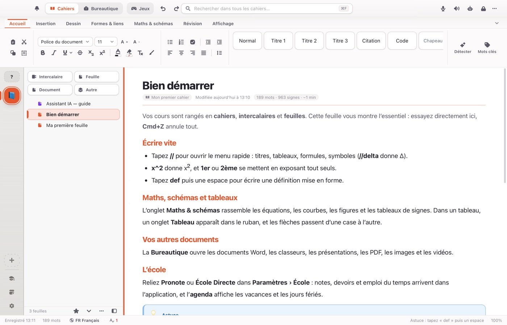

# Multibook : application de notes et de cours gratuite

**Vos cahiers, vos documents et vos révisions dans une seule application**, pour Mac, Windows,
Linux et Android. Gratuit, sans compte.

**[Télécharger Multibook](https://onedrop3d.github.io/multibook-notes/)**

- **Cahiers** : cahiers, intercalaires et feuilles, écriture au stylet, formes, schémas, cartes mentales.
- **Maths et sciences** : équations, courbes, géométrie, tableaux de signes et de variations.
- **Bureautique** : Word, Excel, PowerPoint, OpenDocument et PDF annotables.
- **Révisions** : fiches, jeux de révision et jeux de frappe.
- **Voix et IA** : dictée, lecture à voix haute, assistant IA qui tourne sur votre ordinateur.

Multibook est distribué sous la licence [PolyForm Noncommercial 1.0.0](LICENSE) : usage gratuit
à des fins non commerciales, usage commercial non autorisé.

Ce dépôt contient le site de Multibook. Contact : [onedrop3d@gmail.com](mailto:onedrop3d@gmail.com).
